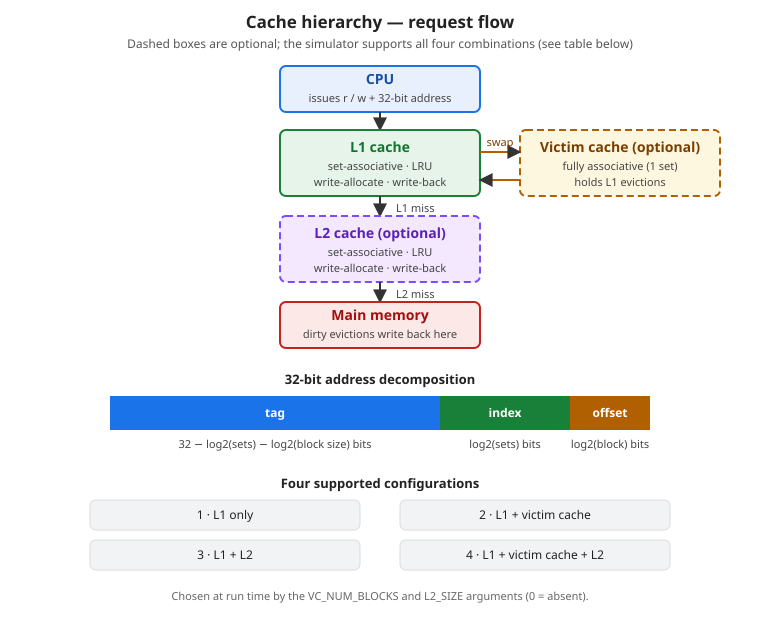
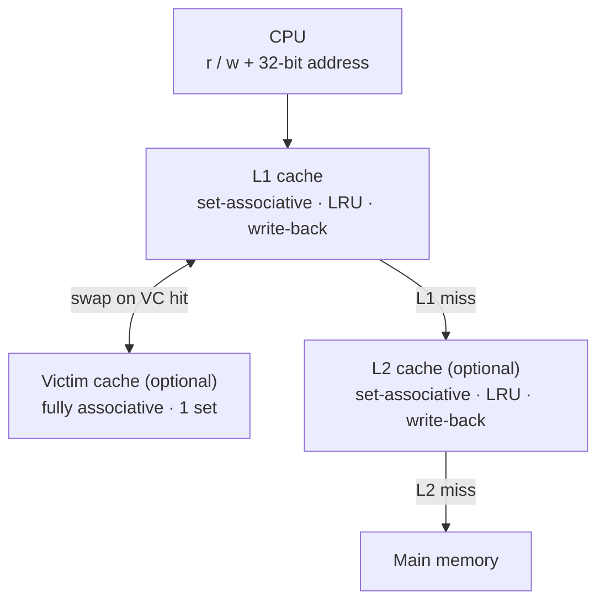
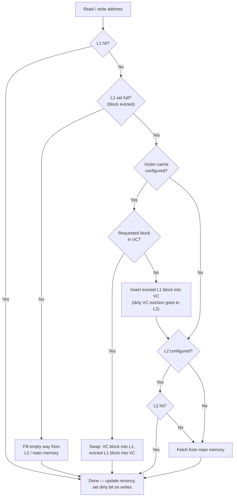
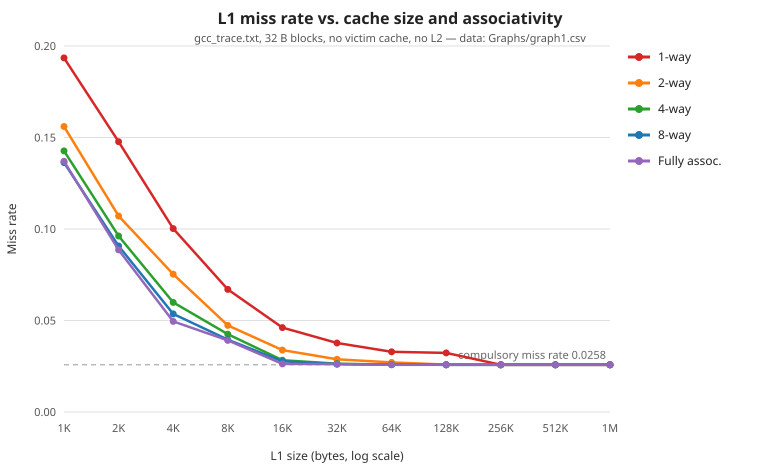

# Cache Simulator

A trace-driven simulator for a **two-level cache hierarchy with an optional victim cache**, written in C++.
It replays a memory-access trace through a configurable L1, victim cache, and L2, then reports hit/miss
statistics, swap behaviour, writebacks, and memory traffic.

Originally built as **Project #1: Cache Design, Memory Hierarchy Design** for
**ECE 563 (Fall 2018, Rotenberg)** at NC State University. The full project write-up is in
[`Report/reportCacheSimulator.pdf`](Report/reportCacheSimulator.pdf).

## What it simulates

- **L1 cache** — set-associative, configurable block size, size, and associativity.
- **Victim cache (optional)** — a small fully associative cache between L1 and L2 that holds blocks
  evicted from L1. On a later reference to a block sitting in the victim cache, the blocks are
  **swapped** back into L1 instead of going to the next level.
- **L2 cache (optional)** — set-associative, configurable size and associativity.
- **Replacement:** true LRU within each set (per-block recency counters, 0 = most recently used).
- **Write policy:** write-allocate + write-back. A write miss allocates the block and marks it dirty;
  dirty blocks are written to the next level only when evicted.
- **Addresses:** 32-bit, split into tag / index / block offset from the configured geometry
  (`index bits = log2(sets)`, `offset bits = log2(block size)`).
- **Input validation:** block size, cache sizes, and associativities must be powers of two, and
  associativity may not exceed the number of blocks per set. Invalid configurations are rejected
  with an error instead of simulating.

## Architecture





### How a request flows



Note that the victim cache is only consulted when an L1 miss actually evicts a block
(the set is full). A miss into an empty way fills straight from L2 / memory.

The simulator picks one of four structures at run time from the arguments
(`VC_NUM_BLOCKS = 0` means no victim cache, `L2_SIZE = 0` means no L2):

| # | Configuration | When |
|---|---------------|------|
| 1 | L1 only | `VC_NUM_BLOCKS = 0`, `L2_SIZE = 0` |
| 2 | L1 + victim cache | `VC_NUM_BLOCKS > 0`, `L2_SIZE = 0` |
| 3 | L1 + L2 | `VC_NUM_BLOCKS = 0`, `L2_SIZE > 0` |
| 4 | L1 + victim cache + L2 | `VC_NUM_BLOCKS > 0`, `L2_SIZE > 0` |

On an L1 eviction the evicted block is offered to the victim cache (configurations 2 and 4).
If the requested block is found there, the two blocks are swapped — that is a **swap**, and it
avoids a trip to L2/memory. If the victim cache itself must evict a dirty block, that block is
written to L2 (configuration 4). Without a victim cache, a dirty L1 eviction is written straight
to L2 (configuration 3).

## Quick start

### Prerequisites

- `g++` (the build uses `-std=c++17 -O3 -Wall -Wextra -Wpedantic` and links `-lm`)
- `make`
- A trace file — one `r`/`w` access per line, e.g. [`ValidationTraces/gcc_trace.txt`](ValidationTraces/gcc_trace.txt)
  (100,000 accesses; format `r 400341a0`, `w dfcfa8`, …)

### Build

From the repository root:

```bash
make          # build code/sim_cache
make clean    # remove binary and objects
make clobber  # remove objects only
make help     # list targets
```

### Run

```bash
make run      # sample configuration (see below)
```

Or run the binary directly:

```bash
./code/sim_cache 32 8192 4 7 65536 8 ./ValidationTraces/gcc_trace.txt
```

That runs: 32-byte blocks, 8 KB 4-way L1, a 7-block victim cache, 64 KB 8-way L2,
over the included GCC trace.

## Command-line reference

```
sim_cache <BLOCKSIZE> <L1_SIZE> <L1_ASSOC> <VC_NUM_BLOCKS> <L2_SIZE> <L2_ASSOC> <trace_file>
```

| # | Argument | Meaning | Notes |
|---|----------|---------|-------|
| 1 | `BLOCKSIZE` | Cache block size, bytes | Power of two |
| 2 | `L1_SIZE` | L1 size, bytes | Power of two |
| 3 | `L1_ASSOC` | L1 associativity | Power of two; ≤ blocks per set |
| 4 | `VC_NUM_BLOCKS` | Victim-cache blocks | `0` = no victim cache; the victim cache is fully associative (1 set) |
| 5 | `L2_SIZE` | L2 size, bytes | `0` = no L2; power of two when non-zero |
| 6 | `L2_ASSOC` | L2 associativity | Power of two; ≤ blocks per set |
| 7 | `trace_file` | Memory trace to replay | Lines of `r <hex addr>` / `w <hex addr>` |

Exactly 7 arguments are required; anything else prints the expected usage and exits.
Sizes are in bytes, and L1/L2 associativity is capped by the number of blocks in a set
(`associativity ≤ size / block size`).

## Output

Every run prints three sections:

1. **Simulator configuration** — the arguments as parsed.
2. **Cache contents** — final tags per set, in hex, most-recently-used first; a trailing `D`
   marks a dirty block. L1 is always shown; VC and L2 only when configured.
3. **Simulation results** — counters labelled `a.`–`p.` (see table below).

### Metrics (results `a.`–`p.`)

| Label | Metric | Definition |
|-------|--------|------------|
| a. | L1 reads | L1 read hits + read misses |
| b. | L1 read misses | |
| c. | L1 writes | L1 write hits + write misses |
| d. | L1 write misses | |
| e. | Swap requests | Victim-cache lookups triggered by L1 evictions |
| f. | Swap request rate | Swap requests ÷ total L1 requests |
| g. | Swaps | Victim-cache hits that exchanged a block with L1 |
| h. | Combined L1+VC miss rate | (L1 read + write misses − swaps) ÷ total L1 requests |
| i. | Writebacks from L1/VC | Dirty blocks evicted from L1 or the victim cache |
| j. | L2 reads | |
| k. | L2 read misses | |
| l. | L2 writes | |
| m. | L2 write misses | |
| n. | L2 miss rate | **L2 read misses ÷ L2 reads** (reads only, not all L2 requests) |
| o. | Writebacks from L2 | Dirty blocks evicted from L2 |
| p. | Total memory traffic | With L2: L2 read misses + L2 write misses + L2 writebacks. Without L2: L1 misses − swaps + victim-cache writebacks |

When a level is not configured its counters stay at zero.

### Example run

Full hierarchy — 16-byte blocks, 1 KB 2-way L1, 16-block victim cache, 8 KB 4-way L2
(`sim_cache 16 1024 2 16 8192 4 gcc_trace.txt`, reference output in
[`ValidationResults/gcc.output3.txt`](ValidationResults/gcc.output3.txt); contents sections elided):

```
===== Simulator configuration =====
  BLOCKSIZE:                  16
  L1_SIZE:                    1024
  L1_ASSOC:                      2
  VC_NUM_BLOCKS:                16
  L2_SIZE:                    8192
  L2_ASSOC:                      4
  trace_file:      gcc_trace.txt

===== Simulation results =====
  a. number of L1 reads:                       63640
  b. number of L1 read misses:                  8322
  c. number of L1 writes:                      36360
  d. number of L1 write misses:                 7680
  e. number of swap requests:                  15938
  f. swap request rate:                       0.1594
  g. number of swaps:                           2859
  h. combined L1+VC miss rate:                0.1314
  i. number writebacks from L1/VC:              7598
  j. number of L2 reads:                       13143
  k. number of L2 read misses:                  5953
  l. number of L2 writes:                       7598
  m. number of L2 write misses:                   24
  n. L2 miss rate:                            0.4529
  o. number of writebacks from L2:              4037
  p. total memory traffic:                     10014
```

The trace has 100,000 accesses (63,640 reads, 36,360 writes). The 16-block victim cache
absorbs 2,859 of the L1 misses as swaps, cutting the combined L1+VC miss rate to 0.1314
from the L1-only miss rate of 0.1600 for this configuration, and total memory traffic falls
from 24,698 (L1 only, `gcc.output0.txt`) to 10,014.

## Validation

[`scripts/validate.sh`](scripts/validate.sh) rebuilds the simulator and replays the GCC trace
under 8 configurations, comparing each run against the reference outputs in
[`ValidationResults/`](ValidationResults/) (comparison starts at `===== L1 contents =====`,
so run-specific header text is ignored):

```bash
./scripts/validate.sh
# Validation complete: 8/8 cases passed.
```

| Case | Arguments (`BLOCK L1 L1_ASSOC VC L2 L2_ASSOC`) | Configuration | Reference |
|------|-----------------------------------------------|---------------|-----------|
| 0 | `16 1024 2 0 0 0` | L1 only, 2-way | `gcc.output0.txt` |
| 1 | `16 1024 2 16 0 0` | L1 2-way + 16-block VC | `gcc.output1.txt` |
| 2 | `16 1024 2 0 8192 4` | L1 2-way + L2 | `gcc.output2.txt` |
| 3 | `16 1024 2 16 8192 4` | Full hierarchy | `gcc.output3.txt` |
| 4 | `16 1024 1 0 0 0` | L1 only, direct-mapped | `gcc.output4.txt` |
| 5 | `16 1024 1 16 0 0` | L1 direct-mapped + 16-block VC | `gcc.output5.txt` |
| 6 | `16 1024 1 0 8192 4` | L1 direct-mapped + L2 | `gcc.output6.txt` |
| 7 | `16 1024 1 16 8192 4` | Full hierarchy, direct-mapped L1 | `gcc.output7.txt` |

Fresh runs land in [`OutputResults/outputN.txt`](OutputResults/) (currently the 8 outputs
matching the validation cases).

## Results and analysis

[`code/bashScript.sh`](code/bashScript.sh) sweeps cache geometries over the GCC trace and dumps
miss-rate data to CSVs in [`Graphs/`](Graphs/) (raw append-mode output — re-running the script
appends a second copy of each table). The plots below are the checked-in PNGs; the analysis is
from the project report.



### Graph 1 — Miss rate vs. L1 size and associativity

32-byte blocks, no victim cache, no L2 ([`Graphs/graph1.csv`](Graphs/graph1.csv),
plot: [`Graphs/graph1.png`](Graphs/graph1.png)). Miss rate falls with both size and
associativity and flattens at the **compulsory miss rate of 0.0258**. At 1 KB:

| Associativity | Total miss rate | Conflict misses |
|---------------|----------------|-----------------|
| 1-way | 0.1935 | 0.0565 |
| 2-way | 0.1560 | 0.0190 |
| 4-way | 0.1427 | 0.0057 |
| 8-way | 0.1363 | ~0 |
| Fully associative | 0.1370 | 0 |

(Capacity misses at 1 KB: 0.1370 − 0.0258 = 0.1112. Conflict misses = total − fully-associative
miss rate, per the report.)

### Graph 2 — Access time vs. L1 size and associativity

[`Graphs/graph2.csv`](Graphs/graph2.csv) extends the Graph 1 sweep with per-configuration
hit time and an average access time computed as
**AAT = hit time + miss rate × miss penalty (20.1 ns)** — e.g. 16 KB fully associative:
0.205608 + 0.0263 × 20.1 = **0.734238 ns**, the minimum in the sweep
(plot: [`Graphs/Graph2.png`](Graphs/Graph2.png)).

### Graph 3 — Adding L2

L1 (1 KB–128 KB) with a 512 KB 8-way L2 ([`Graphs/graph3.csv`](Graphs/graph3.csv),
plot: [`Graphs/Graph3.png`](Graphs/Graph3.png)). The best access time with L2 comes from an
8 KB direct-mapped L1 at **0.721586 ns**, 1.72% below the best L1-only point — but at much
larger total area (0.0533 mm² + 2.6401 mm² vs. 0.0634 mm² for the Graph 2 optimum).

### Graph 4 — Block size

Block sizes 16–128 bytes vs. L1 size ([`Graphs/graph4.csv`](Graphs/graph4.csv),
plots: [`Graphs/Graph4.png`](Graphs/Graph4.png), `Graph4MissRate.png`, `Graph4_2.png`).
Smaller caches prefer smaller blocks; larger caches benefit from larger blocks — the
trade-off between spatial locality and cache pollution shifts with cache size.

### Graph 5 — L1 vs. L2 size

L1 (1 KB–128 KB) against L2 (32 KB–1 MB) ([`Graphs/graph5.csv`](Graphs/graph5.csv),
plot: [`Graphs/Graph5.png`](Graphs/Graph5.png)). Lowest access time: **0.707657 ns**
(L1 2 KB + L2 64 KB). Lowest area within 5% of that access time: L1 1 KB + L2 32 KB
(0.2573 mm², AAT 0.7157522 ns).

### Graph 6 — Victim cache vs. associativity

Direct-mapped L1 with 0–16 victim-cache blocks, compared against 2-way and 4-way L1 with no
victim cache, all with a 64 KB 8-way L2 ([`Graphs/graph6.csv`](Graphs/graph6.csv),
plots: [`Graphs/Graph6.png`](Graphs/Graph6.png), `Graph6_Corr.png`).
At 1 KB, a 16-block victim cache cuts the combined miss rate from 0.1935 (direct-mapped,
no VC) to **0.1125** — better than a 2-way L1 with no victim cache (0.1560). The lowest
access time in the sweep is **0.699615 ns** (2 KB direct-mapped L1, no victim cache).

> **Note on the timing/area figures:** the access-time and area numbers quoted above come from
> the project report. The average-access-time formula is recoverable from `graph2.csv`
> (hit time + miss rate × 20.1 ns miss penalty), but the repo contains no script or tool that
> produced the hit times or areas — see the open questions below.

## Repository layout

```
CacheSimulator/
├── README.md                 # this file
├── Makefile                  # root build wrapper (delegates to code/)
├── .gitignore                # build artifacts (sim_cache, *.o), macOS noise
├── code/
│   ├── sim_cache.cc          # main(): CLI parsing, trace loop, statistics, output
│   ├── sim_cache.h           # cache_params struct (the 7 CLI arguments)
│   ├── Cache.h               # Cache class: set-associative storage, LRU, hit/miss, write-back
│   ├── VictimCache.h         # VictimCache class (extends Cache): swap-in/swap-out logic
│   ├── BitsOffset.h          # tag / index / block-offset bit counts
│   ├── PerformanceParameters.h # hit/miss/swap/eviction/writeback counters
│   ├── Makefile              # g++ -O3 -std=c++17; targets: all, clean, clobber, run, help
│   └── bashScript.sh         # geometry sweeps that produced Graphs/*.csv
├── docs/                     # (proposed) architecture.svg, graph1-miss-rate.svg
├── scripts/
│   └── validate.sh           # rebuild + run 8 validation configs, diff vs. reference
├── Graphs/                   # sweep data (graphN.csv/.xls), raw run logs, result plots
├── ValidationTraces/
│   └── gcc_trace.txt         # 100,000-access GCC memory trace (r/w + hex address)
├── ValidationResults/
│   └── gcc.output[0-7].txt  # reference outputs for the 8 validation configs
├── OutputResults/
│   └── output[0-7].txt      # outputs from the latest validation run
└── Report/
    ├── reportCacheSimulator.pdf   # full project write-up (ECE 563, Fall 2018)
    └── reportCacheSimulator.docx
```

## What was improved

- Stronger build setup (`make`, `make run`, `make help`) via updated makefiles.
- Input validation for invalid cache configurations (power-of-two and associativity checks).
- Guard for the L2 miss-rate divide-by-zero edge case.
- Repository-level `Makefile` for root-level build commands.
- Executable validation script at `scripts/validate.sh`.
- `.gitignore` for common build artifacts.

## Roadmap

- Automated CI checks (build + validation script) for every pull request.
- Unit-level tests for cache operations and edge-case configurations.
- Split core simulator logic from the CLI so it can be embedded as a library.
- Standard benchmark traces and performance baselines for regression checks.
- Migrate configuration parsing to safer, more descriptive command-line flags.
